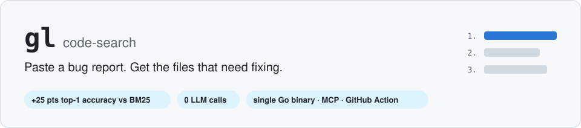
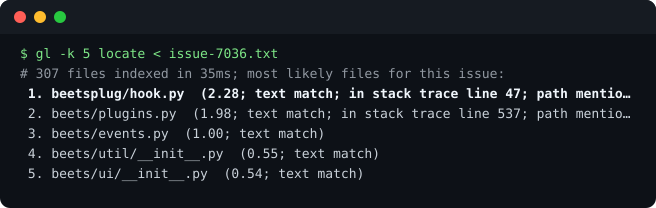
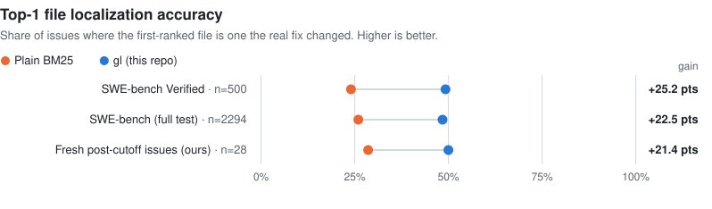
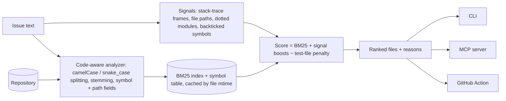

<p align="center">
  <picture>
    <source media="(prefers-color-scheme: dark)" srcset="docs/assets/banner-dark.svg">
    
  </picture>
</p>

<p align="center">
  <a href="https://github.com/soham504/gl-code-search/actions/workflows/ci.yml"></a>
  
  
  
  <a href="LICENSE"></a>
</p>

<p align="center">
  <b><a href="#quickstart">Quickstart</a></b> ·
  <b><a href="#results">Results</a></b> ·
  <b><a href="#does-better-search-help-ai-coding-agents">Agents A/B</a></b> ·
  <b><a href="#use-it-with-your-tools">MCP &amp; GitHub Action</a></b> ·
  <b><a href="docs/findings.md">Full write-up</a></b>
</p>

**`gl` finds the files a bug report is about.** Point it at a repository and give it an issue. It ranks the source files most likely to need changes, in milliseconds on a laptop, with no LLM, no GPU and no index server.

Engineers triaging issues need this, and so does every AI coding agent before it can write a fix. This repo also tests, with real fixes as ground truth, whether a better search tool actually makes those agents better.

<p align="center">
  
  <br><sub>Real output on <a href="https://github.com/beetbox/beets/issues/7036">beets #7036</a>, an issue opened after the model's training cutoff. The fix changed <code>beets/plugins.py</code> and <code>beets/events.py</code>, ranked #2 and #3.</sub>
</p>

## Quickstart

```sh
go install github.com/soham504/gl-code-search/go/cmd/gl@latest     # Go 1.22+

cd your-repo
gl locate < issue.txt                 # ranked likely files, with the reasons
gl search "date field serialization"  # code-aware ranked search with matching lines
gl symbol QuerySet                    # where it's defined
gl -k 5 -markdown locate < issue.txt  # ready to paste into an issue (also: -json)
```

Works on Python, JS/TS, Go, Rust, Java, Kotlin, Scala, C/C++, C#, Ruby and PHP. The first run analyses the repo. After that an on-disk cache re-analyses only changed files: **3.9 s → 0.25 s** on Django's 2,600 files.

## Results

<p align="center">
  <picture>
    <source media="(prefers-color-scheme: dark)" srcset="docs/assets/results-dark.svg">
    
  </picture>
</p>

| Benchmark | Issues | BM25 Acc@1 | **gl Acc@1** | Gain (95% CI) | BM25 Acc@5 | **gl Acc@5** |
|---|---|---|---|---|---|---|
| SWE-bench Verified | 500 | 24.0% | **49.2%** | +25.2 [+21.0, +29.4] | 54.8% | **76.0%** |
| SWE-bench (full test) | 2,294 | 25.9% | **48.4%** | +22.5 [+20.5, +24.4] | 56.2% | **75.0%** |
| SWE-bench Lite | 300 | 25.7% | **48.3%** | +22.7 [+17.3, +28.0] | 55.0% | **72.0%** |
| Fresh issues, opened after the model's cutoff | 28 | 28.6% | **50.0%** | +21.4 [+0.0, +42.9] | 57.1% | **71.4%** |

Acc@k is the share of issues where a file changed by the real fix is in the top k. Ground truth is always the actual fix, never our own labels. More benchmarks are running (SWE-Gym, LocBench, SWE-bench-Live, SWE-rebench, Multilingual, PolyBench); the full table with confidence intervals and per-language results is in [`eval/results/loc_summary.md`](eval/results/loc_summary.md).

<details>
<summary><b>Where the gain comes from</b> (ablation on SWE-bench Lite)</summary>

| Configuration | Acc@1 |
|---|---|
| Plain BM25 (English analyzer) | 25.7% |
| Code-aware analyzer only (`camelCase`/`snake_case` splitting, symbol and path fields) | 39.0% |
| **Full `gl`** | **48.3%** |
| Full, without the test-file penalty | 44.7% |
| Full, without stack-trace and path signals | 46.7% |
| Full, without symbol signals | 46.3% |
</details>

## Does better search help AI coding agents?

We gave the same agent the same 20 issues three times: with **grep only**, with **grep + [Graphify](https://github.com/Graphify-Labs/graphify)** (a popular code knowledge graph), and with **grep + `gl`**. All 380 tool calls went through a logged harness with identical output caps.

| | grep | grep + Graphify | grep + gl |
|---|---|---|---|
| SWE-bench Lite: Acc@1 | 100% | 100% | 100% |
| **Fresh post-cutoff issues: Acc@1** | **85%** | **85%** | **85%** |
| Fresh: calls to the extra tool per run | – | 0.0 | 0.3 |

> [!IMPORTANT]
> **On SWE-bench, agents had memorised the repos.** They grepped straight to the right file on their first search, so SWE-bench can't evaluate agent search tools.
>
> **On fresh issues, agents ignored the extra tools,** and accuracy was identical. All three toolkits missed the same 3 issues, which were reasoning errors, not search errors.
>
> `gl` nearly doubles top-1 accuracy where no LLM is in the loop (triage bots, CI, small local models). A frontier agent with grep was already at 85%. Details, statistics and limitations are in [docs/findings.md](docs/findings.md).

## Use it with your tools

<details open>
<summary><b>Coding agents (MCP)</b></summary>

`gl mcp` serves `locate`, `search` and `symbol` over stdio. It re-scans on every call (cheap thanks to the cache), so results stay fresh while the agent edits.

```sh
claude mcp add gl -- gl mcp                                        # Claude Code
```
```json
{ "mcpServers": { "gl": { "command": "gl", "args": ["mcp"] } } }
```
<sub>Cursor: <code>.cursor/mcp.json</code>. Our A/B shows agents rarely pick a new tool unprompted, so tell yours to start with <code>locate</code>.</sub>
</details>

<details>
<summary><b>Issue triage bot (GitHub Action)</b></summary>

This posts the top-k likely files as a comment on every new issue. It's where `gl` measurably helps, because no LLM is in the loop.

```yaml
# .github/workflows/issue-triage.yml in the repo you want triaged
on: { issues: { types: [opened] } }
permissions: { issues: write, contents: read }
jobs:
  suggest-files:
    runs-on: ubuntu-latest
    steps:
      - uses: actions/checkout@v4
      - uses: soham504/gl-code-search@main
        with: { k: "5" }
```
<sub>The comment format is tested locally; the Action hasn't been run on a real repository yet.</sub>
</details>

## How it works



<details>
<summary><b>Reproduce everything</b></summary>

```sh
make test                                                   # Go + Python unit tests
python3 -m venv .venv && .venv/bin/pip install pyarrow -e '.[dev]'
.venv/bin/python harness/datasets.py                        # 8 public benchmarks → data/bench/
go build -o bin/locbench ./go/cmd/locbench
./bin/locbench -data data/bench/swebench_verified.jsonl -repos data/repos -name verified -fetch -j 8
python3 harness/mine.py > data/fresh/instances.jsonl        # fresh post-cutoff issues from git history
.venv/bin/python -m groundline.locsummary                   # cross-benchmark table
.venv/bin/python -m groundline.readme_assets                # regenerate the charts on this page
```
The agent A/B prompt and workflow are in [`harness/agent_ab.workflow.js`](harness/agent_ab.workflow.js); the dispatcher that enforces each toolkit is [`harness/tool.py`](harness/tool.py).
</details>

<details>
<summary><b>Repository layout</b></summary>

| Path | What |
|---|---|
| `go/internal/code` | Analyzer, symbol extraction, issue signals, ranking, analysis cache, git-object loader |
| `go/internal/index` | Inverted index + BM25 |
| `go/cmd/gl` | CLI and MCP server |
| `go/cmd/locbench` | Offline localization benchmark with ablations; fetches single commits on demand |
| `action.yml` | GitHub Action |
| `harness/` | Dataset normalisation, fresh-issue mining, agent tool dispatcher, A/B workflow |
| `py/groundline/` | A/B statistics, cross-benchmark summary, chart generation |
| `eval/results/` | Every report and per-instance result |
| `docs/findings.md` | Full write-up with limitations |
| `go/cmd/bench`, `go/cmd/searchd`, `docs/archive/` | Earlier work: BM25 on BEIR, a self-graded grounding pilot (superseded) |
</details>

## Limitations

- **Small agent study:** 20 issues per condition and one model; tools were offered, not required.
- **Simple symbol extraction:** it's regex-based. It finds types but not methods in Java and C#.
- **Fresh-issue gold isn't hand-checked:** it comes from `Fixes #N` commits.

See [docs/findings.md](docs/findings.md#limitations) for the rest.

<sub>MIT licensed. Built with Go, plain BM25, and careful measurement.</sub>
